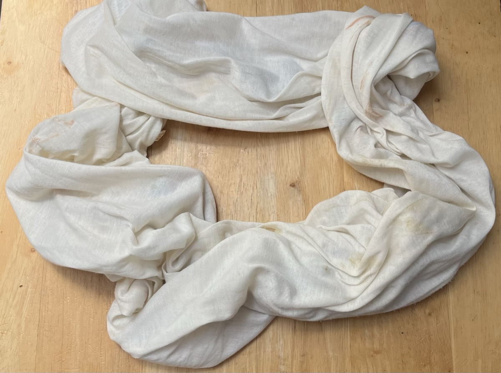
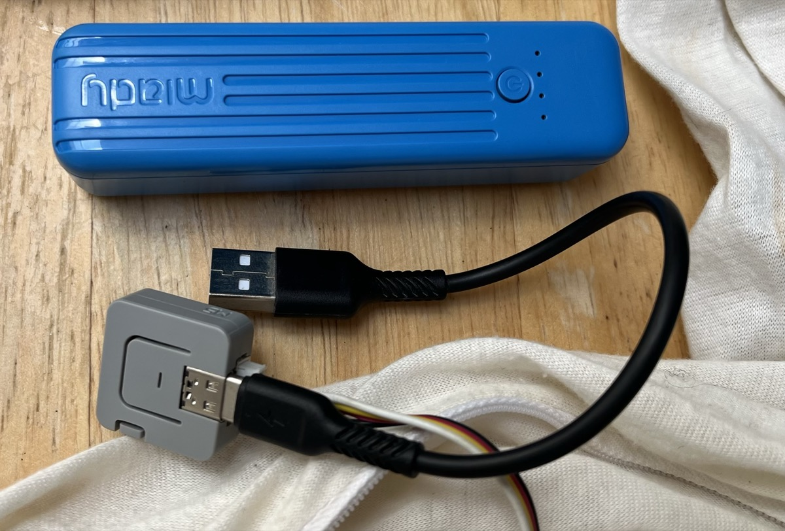
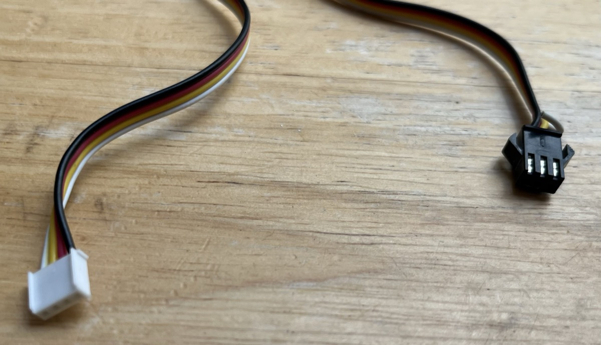
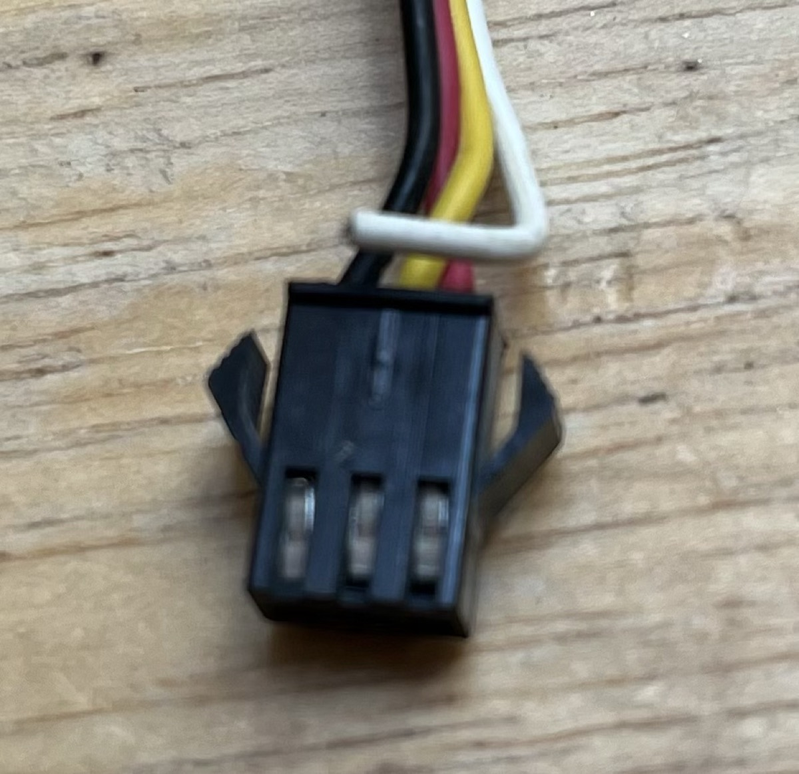
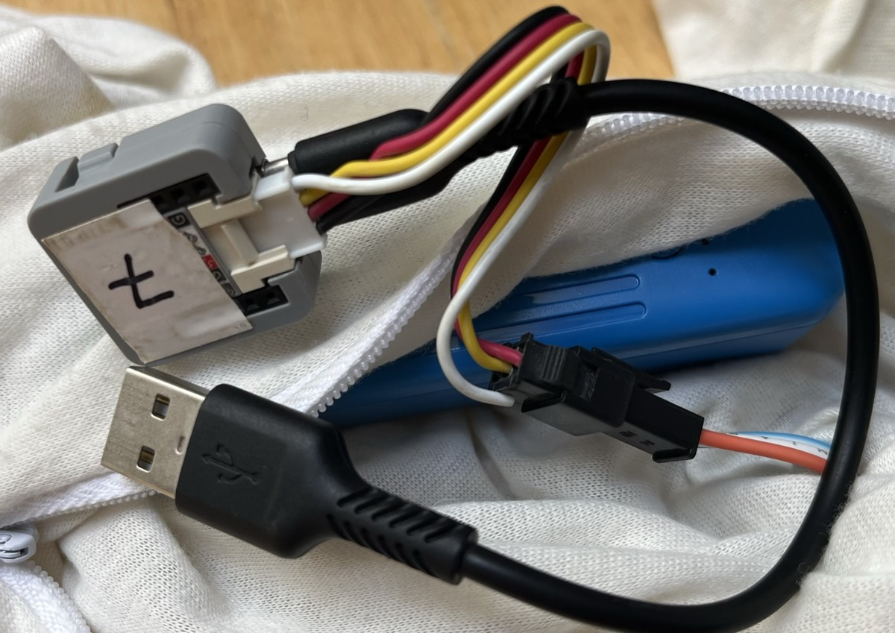

# Scarfnet

ESP32-based (M5Stack Atom Lite) firmware that coordinates LED patterns across a mesh network of wearable scarves. Each scarf runs the same firmware and uses ESP-NOW broadcasts to synchronize button presses, tempo and LED animations in real time, with no central coordinator.

## Prerequisites

- [PlatformIO](https://platformio.org/) (CLI or VS Code extension)
- [uv](https://docs.astral.sh/uv/) for any standalone Python scripts in `tools/`

## Hardware

One complete scarf node requires the following:



### Controller

[ATOM Lite ESP32 IoT Development Kit](https://shop.m5stack.com/products/atom-lite-esp32-development-kit)

This is the core of Scarfnet. 

Any ESP32 controller will work, but if you do not use this specific controller, then your IO pins and button may be on a separate GPIO and thus might require custom Scarfnet firmware for your unit. And if that is the case, then you won't be able to use OTA updating from other scarves in the future. So just use this one.



### Battery

Any small ~5000mAh USB battery pack works. Tested with:
[SIXTHGU Portable Charger](https://www.amazon.com/dp/B0FJG8YKQH)

I recommend getting them anywhere except Amazon if at all possible.

The battery connects to the USB-C port on the controller via a short USB-A or USB-C cable. Smaller is better — everything needs to fit in the scarf's zippered pocket.

### Cable (controller → LEDs)

We will be creating an custom 4-pin Unbuckled Grove to 3-pin JST-SM 2.5mm cable. This is the trickiest part of the whole product. If you are friends with the Scarfnet creator, it may be best to just ask him to create one for you.

[Unbuckled Grove Cable](https://shop.m5stack.com/products/4pin-buckled-grove-cable) — get a short length for a standard scarf, or longer if adapting to a different form factor.

You'll cut this cable in half and terminate one end with a JST-SM connector to match the LED strip's input connector.

For the JST-SM connector side, two options depending on your comfort with crimping or soldering:

- **Bare un-crimped connectors** (cleanest result, but requires a crimping tool):
  [JST SM 2.5 mm Pitch 3-Pin Electronic Connectors](https://www.amazon.com/dp/B085RC16VK)
  You'll also need a JST-compatible crimper to terminate the wires.
- **Pre-crimped connectors** (easier — just solder and cover):
  [3-pin JST SM Plug + Receptacle Cable Set](https://www.adafruit.com/product/1663)
  You'll need a soldering iron and heat shrink tubing to protect each joint.




### LED Strip

For the LEDs, I recommend a LED strand where each LED is ~4in apart, and which is sturdy for outdoor use. LED strips or fairy-light-style LEDs can work, but they may be too delicate or awkward to work with.

Any of these will work and produce matching colors with other scarves:

| Option | Link |
|---|---|
| Adafruit NeoPixel LED Dots | <https://www.adafruit.com/product/3631> |
| ALITOVE WS2811 12mm waterproof 5V | <https://www.amazon.com/dp/B01AG923GI> |
| Adafruit NeoPixel LED Ball | <https://www.adafruit.com/product/5984> |

The important thing is that Scarfnet only supports a max of 25 LEDs (due to current and wattage limitations). 20-LED scarves will work just fine, but the last 5 pixels of the pattern just won't show.

I recommend the Adafruit NeoPixel LED Dots, to avoid Amazon where possible. 

If you buy the ALITOVE strand, those have 50 LEDs in a strand, so you will be able to make 2 scarves out of one strand - you will need to cut the strand in half and attach a JST-SM connector on the second unit.

> **Note:** Other WS2812-compatible strands may work but could have a different RGB channel order, causing color mismatches between scarves. By default, a new scarf selects the color order for the ALITOVE strand above. To switch to either of the other styles, use the extra-long button press on the controller to cycle the LED type and select the correct color order for your strip.

### Scarf

Any white infinity scarf with a zippered pocket works. Tested with:
[Hidden Zipper Pocket Scarf](https://www.amazon.com/dp/B01N4C65RE).

Basically, any ~30-40 inch infinity scarf will work, but I'm sure you can think of other form factors to use. We've mounted Scarfnets on bikes, backpacks, etc - just make sure there's a spot to put the controller and battery. But we do find infinity scarves to be the most modular and useful.

### Assembly

First, unzip the pocket and unstitch a few stitches from the inside so that you can feed the LED strand through inside the scarf. Eventually, you will have fed all of the LEDs through. Tie the first and last LEDs together (I use a twist-tie) inside the scarf so that they don't bunch up.

Then, leaving the JST-SM end out, sew up the part of the pocket you opened except for the last bit where the cable sticks out.

Now, create your Grove-to-JST-SM connector. Make sure to connect the JST-SM side in such a way that the wires match up with the LED connector cable (Red to red, black to black, and then usually yellow will be in the middle). The white connector will be left unconnected.

Finally, flash your M5 Atom controller to the latest Scarfnet firmware. The first time you will need to connect it to a computer and use PlatformIO to build and upload the firmware (or have the Scarfnet creator do it for you). After that, however, subsequent upgrades can happen over-the-air from another upgraded Scarfnet unit.

### Assembled

Everything fits inside the zippered pocket: M5 controller, USB battery, USB-A to USB-C cable, and the custom Grove-to-JST-SM connector.



## Getting Started - software

Create `include/login.h` (gitignored) with your OTA credentials:

```cpp
#pragma once
#include <string>
const std::string kMeshPassword = "your-ota-password";
constexpr const char* kOtaHttpUser = "your-ota-http-user";
```

The main Scarfnet network has a unique password and username. If you want to be a part of this main network, you should ask the Scarfnet creator or just have them flash your unit.

## Build & Flash

```bash
# Build for the embedded target
pio run -e m5stack-atom-lite

# Flash to device
pio run -e m5stack-atom-lite --target upload

# Monitor serial output
pio device monitor --baud 115200

# Build, flash, and monitor in one step
pio run -e m5stack-atom-lite --target upload && pio device monitor
```

## Running Tests

Tests run on the native (desktop) platform — no hardware required.

```bash
# Run all tests
pio test -e native

# Run tests with verbose output
pio test -e native -v
```

Tests live in `test/test_scarfnet/`, one subdirectory per component. `test_main.cpp` is the entry point that calls each component's test suite. Logic worth testing lives in hardware-free headers in `include/` (e.g. `clock_sync.h`, `sync_state.h`, `tempo_sync.h`, `ota_auto.h`) that the tests include directly.

## Monitoring

Serial runs at 115200 baud. Per-heartbeat lines (`[SND]`, `[MESH][RCV ...]`, `[SYNC] offset=`) are off by default, because serial output blocks the loop once the UART buffer fills; set `kVerboseLogging` in `config.h` to see them. Always logged: joins and leaves, pattern accepts, `STUCK?` rejections, unknown patterns, clock jumps, rx-queue drops and OTA activity.

To see which firmware the whole fleet runs, reboot a USB-connected scarf and read the join lines: each peer logs `[MESH] node <id> joined ver=<version>` as it is first heard.

## Architecture

`Scarf` (`include/scarf.h`, `src/scarf.cpp`) is the top-level coordinator. It wires the subsystems below together; mesh callbacks are dispatched on the loop task, so all `Scarf` state is single-threaded.

### Mesh (`include/Mesh.h`, `src/Mesh.cpp`)

Connectionless mesh over ESP-NOW broadcast on a fixed channel. Every scarf broadcasts a CRC-checked heartbeat (`heartbeat_packet.h`) every few seconds; join and leave events are synthesised from the heartbeat stream by timeout (`node_tracker.h`). Received packets are queued by the WiFi-task callback (`rx_queue.h`) and handled on the loop task.

### Clock sync (`include/clock_sync.h`)

Each heartbeat carries the sender's network clock. The first few samples hard-set the local estimate; after that, small differences are tracked with an EMA and slewed in gradually (the clock speeds up or slows down, never runs backward), while a peer far ahead is jumped to and one far behind is ignored. Groups of scarves that booted apart therefore converge on the furthest-ahead clock.

### Sync protocol (`include/sync_state.h`, `include/sync_controller.h`)

A button press bumps the shared `changeIndex`, picks a fresh randomizer and switches pattern locally, then broadcasts at once. Every heartbeat carries `(changeIndex, randomizer, lastPressId, pattern)`; a receiver adopts the state only if it is newer — higher `changeIndex`, then higher randomizer, then higher presser ID — so simultaneous presses resolve the same way everywhere. A scarf that accepts a new state re-broadcasts it after a short random delay, so a change floods the network instead of waiting for the next heartbeat. A newly joined peer triggers a short burst of extra heartbeats.

If a peer names a pattern this firmware doesn't have, the built-in LED flashes red and the update is retried on later heartbeats.

`SyncController` holds a scarf's replicated state and makes every receive and local-press decision; `Scarf` applies the results to the hardware. Its tests include whole fleets on a lossy network (`test/test_scarfnet/sync_controller/`).

### Tap tempo (`include/tap_tempo.h`, `include/tempo_sync.h`)

Tempo travels in the heartbeat as a beat interval and phase, versioned by its own `tempoIndex` so only newer tempo state is adopted. Only one scarf taps at a time: a scarf in tap mode that hears a newer tempo has been taken over and leaves tap mode.

### ObservableButton (`include/ObservableButton.h`, `src/ObservableButton.cpp`)

Polls the button on a `TaskScheduler` task, debounces it (`button_debouncer.h`), classifies presses (`button_state_machine.h`) into `eDown`, `ePress`, `eLongPress` and `eExtraLongPress`, and notifies observers.

### PatternManager (`include/PatternManager.h`, `src/PatternManager.cpp`)

Owns the pattern list (`src/patterns.cpp`, `src/patterns/*.cpp`) and the active pattern, crossfades between patterns and palettes, and picks the next pattern with a bias toward ones not seen recently. Patterns render from the synced clock and the shared randomizer, so every scarf draws the same thing; `localRnd` adds per-scarf variation.

### OtaManager (`include/OtaManager.h`, `src/OtaManager.cpp`)

Peer-to-peer firmware updates over a temporary WiFi AP. In OTA mode the mesh is not started.

**OTA mode**: hold the button at boot for 5 s (yellow blink countdown); releasing early cancels. The scarf starts as a Receiver.

- **Receiver** (slow yellow blink): scans for a `scarfnet-ota-v{N}` AP, connects, fetches `/info`, and downloads and flashes the firmware if it is newer. LED feedback: orange during scan → white strobes on connect → red pulse speeding up during download → solid green on success.
- **Server** (purple blink): hold the button 5 s while in Receiver mode. Starts a WPA2 AP on the ESP-NOW channel and serves the running firmware over HTTP (`/info` JSON metadata, `/firmware` raw binary), streaming it straight from flash. It serves one receiver at a time and drops a stalled one.

**Automatic updates**: a scarf in normal operation that has seen a peer on newer firmware (red sync blink) periodically scans the ESP-NOW channel for an OTA server in the background. If it finds one newer than itself it restarts into Receiver mode, and restarts back to normal if nothing installs in time. After failed attempts it backs off, waiting longer after boot each time up to a cap (`ota_auto.h`). To update a fleet: flash one scarf, let the others see it, then put it (or any updated scarf) into Server mode.

**Security**: double version check (SSID name + `/info` JSON), WPA2 AP and HTTP Basic Auth using the credentials in `login.h`. Receivers reject downgrades.

**Partitions**: OTA needs the dual app partitions of `min_spiffs.csv`. The NVS partition holds the per-scarf LED type; `tools/pio_guard_nvs.py` fails the build if it would move and blocks `-t erase`, so updates never reset it.

### Built-in LED

| Indication | Meaning |
|---|---|
| Brief blue blink, in step across the fleet | Normal; the blink is timed on the synced clock |
| Brief red blink instead of blue | A peer runs newer firmware |
| Rapid red flashes | A peer named a pattern this firmware doesn't have |
| Dim green, bright green on the beat | Tap-tempo mode |

### Button Behaviors

| Press | Action |
|---|---|
| Short press | Next pattern; in tap-tempo mode, tap the beat |
| Long press | Toggle tap-tempo mode (with `kTapTempoOnLongPress` off: same pattern, new randomizer) |
| Extra-long press | Cycle the LED strip type and reboot |
| Hold at boot | Enter OTA mode |

### LED Types

Three strip color orders are supported, persisted in NVS (`Preferences`):
- `kLedType_Adafruit` (GRB) — Adafruit NeoPixel Dots
- `kLedType_Amazon` (RGB) — ALITOVE WS2811; the default for a new scarf
- `kLedType_Bike` (BGR) — Adafruit NeoPixel LED Balls

The extra-long press cycles through them; the choice survives reboots and firmware updates.

## Key Configuration Files

| File | Purpose |
|---|---|
| `include/login.h` | **Gitignored.** OTA password and HTTP user. Must be created locally. |
| `include/config.h` | All timing and tuning constants, `kScarfVersion` (increment before OTA flashing), and `kVerboseLogging`. Single source of truth — never hard-code timing values elsewhere. |
| `include/defines.h` | Pin assignments, LED count, LED type enums, `SCARFNET_EMBEDDED` compile guard. |
| `include/typedefs.h` | Core type aliases: `Leds` (`std::vector<CRGB>`) and `Rnd` (`uint16_t`). |

## Pattern Simulator

A native terminal simulator lets you preview all patterns on N simulated scarves without hardware. It uses ANSI truecolor escape codes to render LED colors directly in the terminal — no dependencies beyond the system compiler.

```bash
cd tools/sim
make        # build
make run    # build and run
```

The simulator renders up to 8 scarves as rows of colored blocks, animating at ~30 fps:

```
Scarfnet Simulator  pattern: dance        ● 120 BPM  seed: 0x1A2B  scarves: 4
--------------------------------------------------------------
S1 ██████████████████████████████████████████████████
S2 ██████████████████████████████████████████████████
S3 ██████████████████████████████████████████████████
S4 ██████████████████████████████████████████████████
--------------------------------------------------------------
[SPC] next  [R] seed  [T] tap tempo  [+/-] scarves  [Q] quit
```

| Key | Action |
|---|---|
| `SPACE` | Advance to the next pattern |
| `R` | New global seed — same pattern, different look |
| `T` | Tap tempo (two taps sets BPM; further taps refine) |
| `+` / `-` | Add or remove simulated scarves (1–8) |
| `Q` / `ESC` | Quit |

The sim compiles the real pattern engine (`src/patterns/`, `PatternManager`, `palettes`) natively. Hardware-only code (`Mesh`, `Arduino.h`, FastLED gradient palettes) is gated behind `#if SCARFNET_EMBEDDED`. The fastled_stub (`include/fastled_stub.h`) provides CRGB, palette math, noise, and trig for native builds.

## Python Tooling

Scripts live in `tools/`. Use `uv` — never bare `python3`. `tools/pio_guard_nvs.py` is a PlatformIO extra script and runs inside PlatformIO's own Python.

Standalone scripts use [PEP 723 inline script metadata](https://peps.python.org/pep-0723/) to declare their Python version and dependencies.
